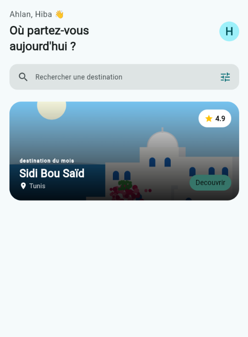
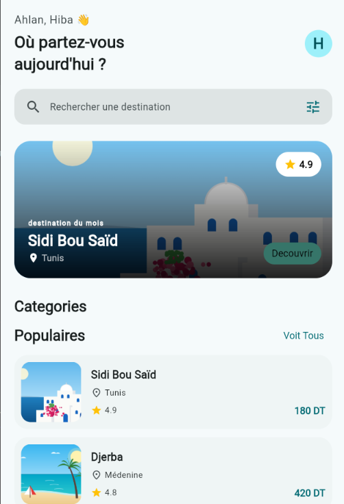
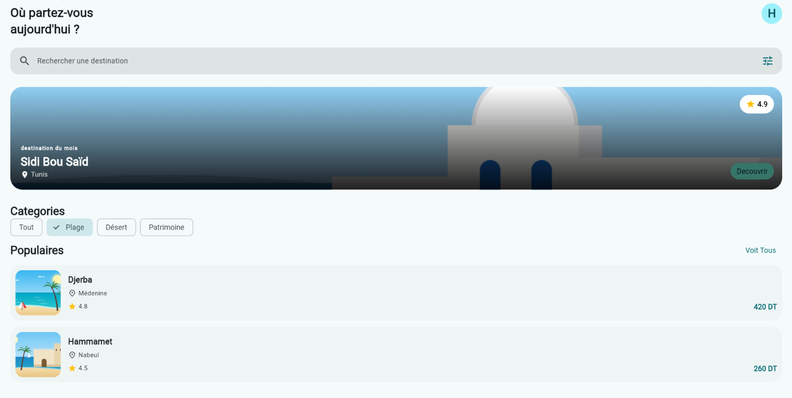
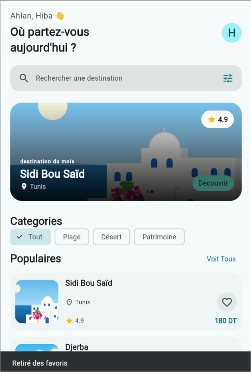

# rihla

A new Flutter project.

## Getting Started

This project is a starting point for a Flutter application.

A few resources to get you started if this is your first Flutter project:

- [Learn Flutter](https://docs.flutter.dev/get-started/learn-flutter)
- [Write your first Flutter app](https://docs.flutter.dev/get-started/codelab)
- [Flutter learning resources](https://docs.flutter.dev/reference/learning-resources)

For help getting started with Flutter development, view the
[online documentation](https://docs.flutter.dev/), which offers tutorials,
samples, guidance on mobile development, and a full API reference.

Palier2:
Q1: without expanded the column takes only the space it needs, the avatar moves closer to the column

Q2: prenom is declared final because it cannot change after its given a value

Q3: cs.primary is a color that comes from the theme while colors.teal is a fixed color so if we change seedcolor cs.primary adapts but colors.teal stays always the same

Palier3:
Q4: the image looks brighter because its in front of the gradient that is supposed to darken it a little

Q5: the corners become squared instead or rounded

Q6: the texts are right: 130 so they dont overlap the button 

palier4:
Q7: Expanded gives enough width to seperate the rating and price

Q8: just adding a 7th destination in the list destinations.dart is enough since i have the for loop in the home screen to display all destinations

palier5:
Q9: in memory _categorie = c changes the value of _categorie to c but in screen nothing updates automatically because setState() was not called

Q10: because _filtrees calculates the list and show the items matching the selected category everytime build() runs so it stays updated

Q11: because it does not change data it only displays the same information 

palier6:
without a key the heart dissapears when we change categories but with a key the heart stays on the ccard even when we change categories

palier7:
