# rihla

A new Flutter project.

## Getting Started

This project is a starting point for a Flutter application.

A few resources to get you started if this is your first Flutter project:

- [Learn Flutter](https://docs.flutter.dev/get-started/learn-flutter)
- [Write your first Flutter app](https://docs.flutter.dev/get-started/codelab)
- [Flutter learning resources](https://docs.flutter.dev/reference/learning-resources)

For help getting started with Flutter development, view the
[online documentation](https://docs.flutter.dev/), which offers tutorials,
samples, guidance on mobile development, and a full API reference.

Palier2:
Q1: without expanded the column takes only the space it needs, the avatar moves closer to the column

Q2: prenom is declared final because it cannot change after its given a value

Q3: cs.primary is a color that comes from the theme while colors.teal is a fixed color so if we change seedcolor cs.primary adapts but colors.teal stays always the same

Palier3:
Q4: the image looks brighter because its in front of the gradient that is supposed to darken it a little

Q5: the corners become squared instead or rounded

Q6: the texts are right: 130 so they dont overlap the button 

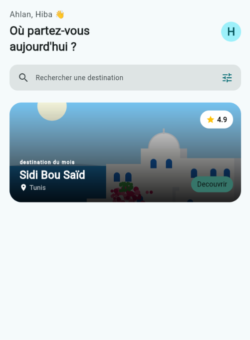

palier4:
Q7: Expanded gives enough width to seperate the rating and price

Q8: just adding a 7th destination in the list destinations.dart is enough since i have the for loop in the home screen to display all destinations

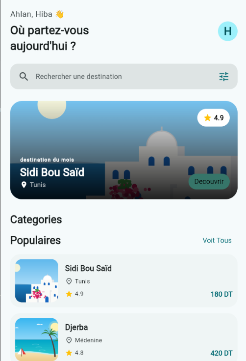

palier5:
Q9: in memory _categorie = c changes the value of _categorie to c but in screen nothing updates automatically because setState() was not called

Q10: because _filtrees calculates the list and show the items matching the selected category everytime build() runs so it stays updated

Q11: because it does not change data it only displays the same information 

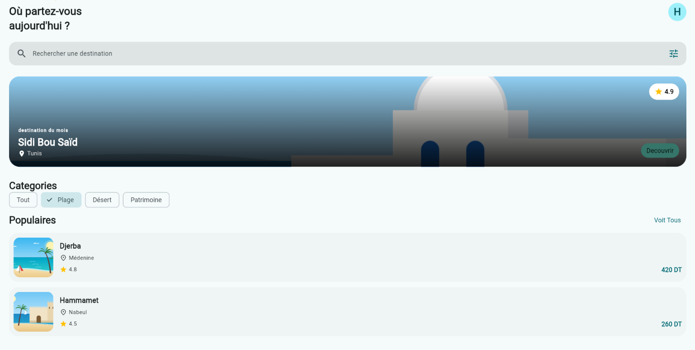

palier6:
without a key the heart dissapears when we change categories but with a key the heart stays on the ccard even when we change categories

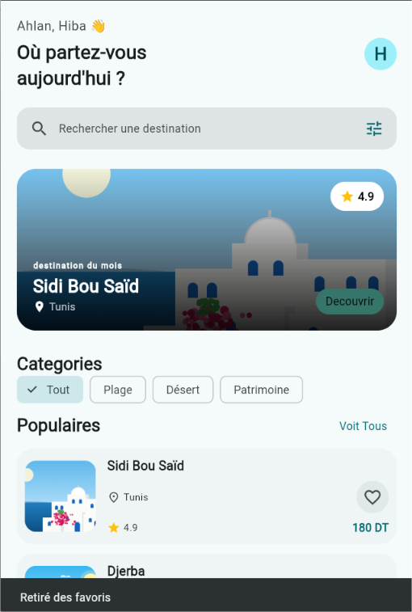

palier7:
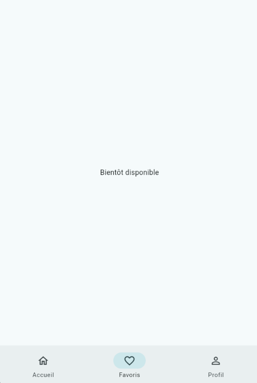

Devoir:
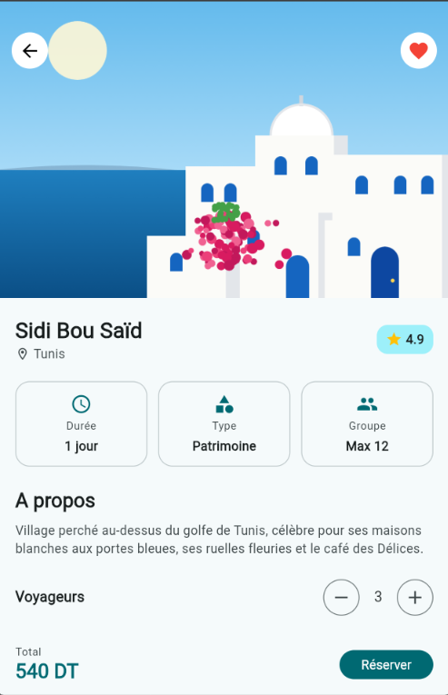 
//Mzel favoris f detail screen w max groupe w max travelers 

Tp5/Palier2:
Q1: The filter is conserved, HomeScreen stays in the pile when we open the DetailScreen, Navigator.pop() closes only the DetailScreen leaving HomeScreen on its previous state

Q2: DetailScreen receives the desstination in the parametres in the constructor

Q3: After removing clipbehaviour InkWell overflows when we touch the card

Palier3:
Q1: _formKey.currentState!.validate() runs the validators, returns true if the fields are valid, or false if not 

Q2:  inputFormatters control what the user types while validator checks if it's valid when submitting the form

Q3: dispose() cleans up the controller when we finish using it

Palier4:
Q1: date is readonly because the user must select the date from the calender instead typing it manually otherwise he can type an invalid date

Q2: We do not need to update the getter _total because it works dynamically and doesn't need manual update

palier5:
Q1: reservation stays null since the user did not clickk confirm

Q2: "Don't use BuildContext across asynchronous gaps" mounted checks if a widget is still active

Q3:the .pop closes the dialog and returns to the previous screen because it is part of the navigation stack

Tp6/Palier2:
Q1: fromJson uses factory constructor because normal constructors have strict rules they can not run the logic before making an object and they can not statement

Q2: the "as int" fails at runtime with an error because "420" is a string

Q3: the server answer is not instant, the list will arrive later so the app does not freeze waiting 

Palier3:
Q1: because late allows us to declare it without giving it a value immediately

Q2: the user see an error screen instead of a clear error message

Q3: no the destinations already loaded once changing the category only filters the data so the interface can update immrdiately

Palier4:
Q1: the server already has the destination it's enough to send destiationId

Q2: without content-type application/json the server does not recognise the body is a json

Q3: we test mounted after await because the user may leave the screen while waiting for the server's response, if the screen does is closed we use context to provoke an error message
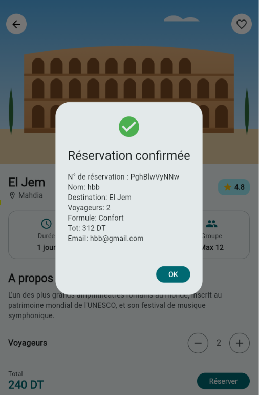
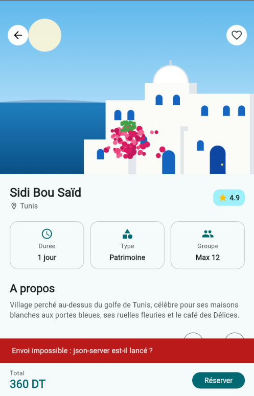
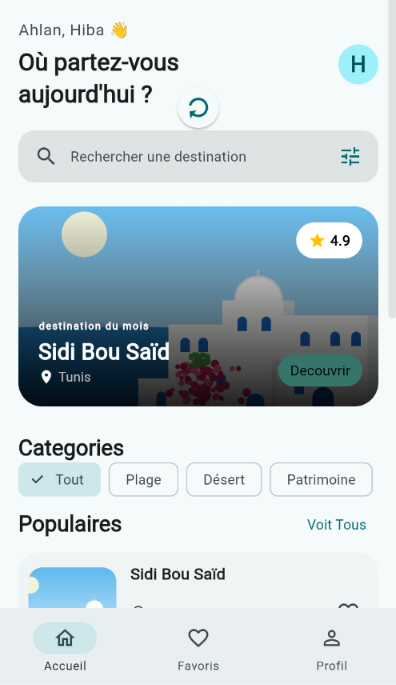
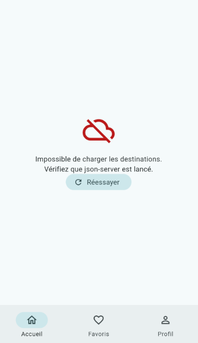

Emulator:
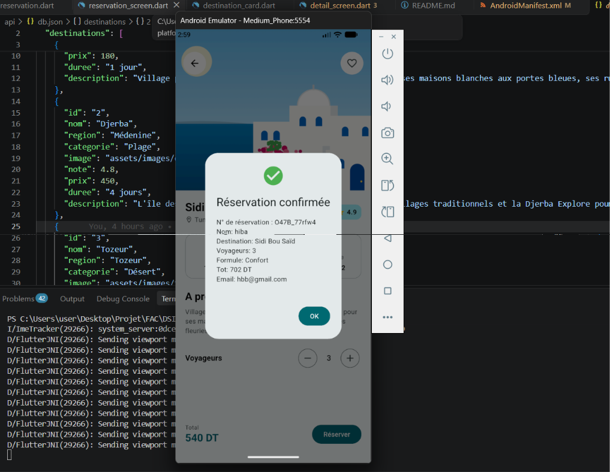
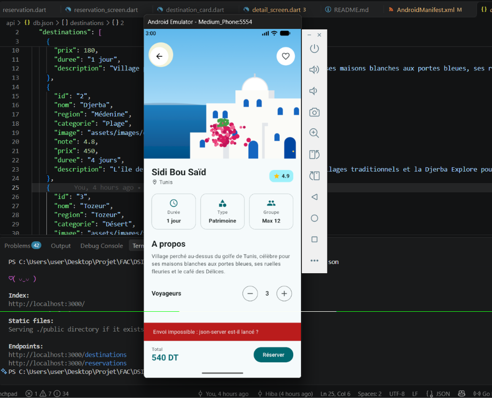